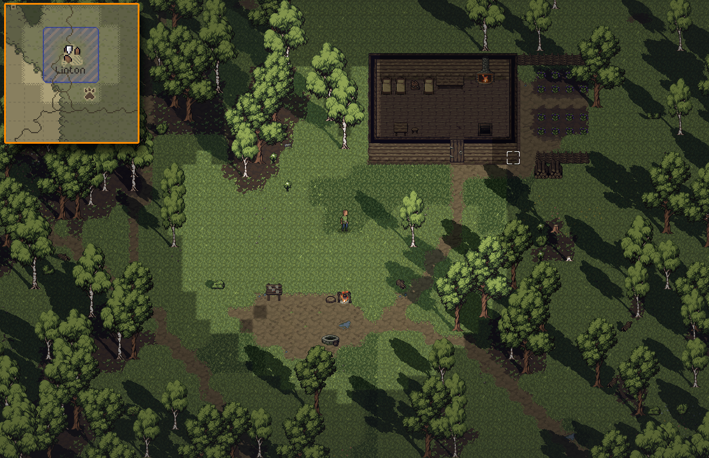
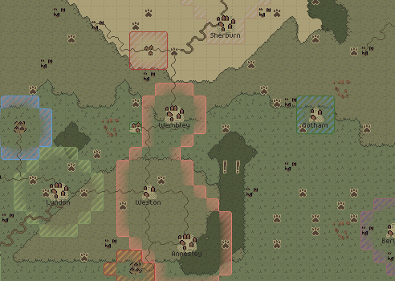

- [Wishlist on Steam](https://s.team/a/3939340?utm_source=website_update)
- [Join the Discord](https://discord.gg/BHWJMftS9r)
- [Become a Patron and play the full release early](https://www.patreon.com/cw/Jouwee)

-----------

# Main features

***Hamlets, Villages & Towns***. Settlements now evolve over time, growing as their population rises;

***Food, please***. NPCs now require food to survive. They grow food in their backyards, or in designated farms. Settlements have food stockpiles for hard times, and people also stock on food. You can also steal or add food to these stockpiles;

***A Denser World***. The world density was rebalanced to decrease the (real-life) travel time between different settlements, or between quests and points of interest. The road generation has also been tweaked;

# Patch notes

## Gameplay
- NPCs in settlements now require food to survive;
- Farmhouses and farms now produce crops;
- Human settlements are now subdivided into hamlets, villages and towns, based on their sizes;
- Forts are only spawned by towns, and use their parent town's food supply;
- Towns also spawn farms sub-settlements (Satellites), that produce their food;
- You can now find a household's food stockpile stored in their barrels. Taking their food might make them starve;
- Villages and Towns spawn Granary buildings, which stores the whole settlement food stockpile;
- Redone most buildings from villages, from houses to the "castle" that was the ruler's building;
- You can see the farmhouses growing crops, and harvesting those crops is considered a crime. It will also affect the house's food supply;
- Area size increased to 128x128 (Was 80x80);
- Time is now tracked during regular play (Doesn't do much yet, but a preparation for next update);
- Most wooden furniture now decays into wood rubble when the building is abandoned;
- Road generation was reworked to avoid grid-like roads and improve connectivity;
- You can now store items in containers, not only take items;
- A personal chest will spawn in your home structure;
- "Grokker Captive" and "Lost in The Wilderness" scenarios now have quests that point you to your home;
- 3 bounty new quests for bandits & grokkra;
- Is most "Lost person" quests, you might have a chance to find the person still alive;

## UI

## Balance
- The world is now a lot more dense, points of interest and quests are closer to settlements, and settlements are closer to each other;

## Bugfixes
- Fixed big performance hit when hovering your mouse over unreachable areas (e.g. Inside houses with closed doors);
- Fixed the rendering of the Primeval Forest on the overworld;
- Fixed overlapping spawns in predator dens;
- Fixed pressing Alt to compare equipment also using the Look action;
- Fixed dragging skills from the hotbar sometimes getting stuck on the mouse;
- Fixed travel plan not always using available roads;
- Fixed blacksmiths sometimes not spawning wearing aprons;
- Fixed ranged enemies (mainly archers) not keeping their distance;
- Fixed the hotbar settings not being saved sometimes;