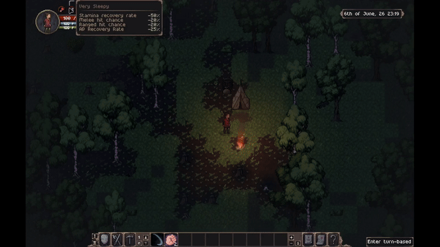
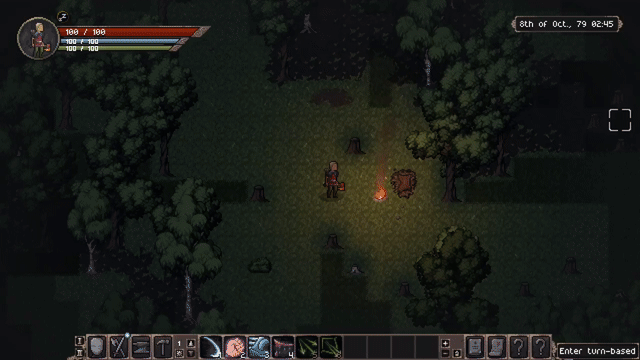
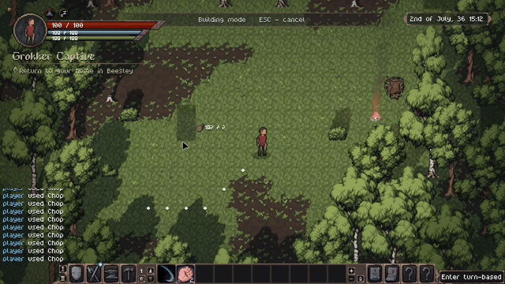

- [Wishlist on Steam](https://s.team/a/3939340?utm_source=website_update)
- [Join the Discord](https://discord.gg/BHWJMftS9r)
- [Become a Patron and play the full release early](https://www.patreon.com/cw/Jouwee)

-----------

# Main features
 
***Hunger, Sleep, and Durability***. The Survival game trifecta is now also part of Tales of Kathay. Eat regularly to fend off hunger, return home to rest and sleep the night, and maintain or replace your gear after it get's worned down;

***Day & Night cycle***. The game now reflects the passage of time, with different lighting changes, and new torches to fend off the darkness;

***Building mode***. Claim an area as yours and build your own base from scratch, or setup small camps as you travel;

# Patch notes

## Gameplay
- New "Hunger" need, that decays over time, and replenishes by eating food;
- New "Sleep" need, that decays over time and replenishes by sleeping;
- Several new Status Effects that creatures receive from Sleep and Hunger;
- Time now passes at a rate of 1 minute per turn, and the global lighting changes to reflect that;
- Being in darkness reduces your vision range;
- Most lights now have a small animated flicker;
- Grokkra and Humans can now use a "Call for Help" action that alert nearby allies;
- New "Building" mode, where you can place most flooring and objects;
- You can now claim an area as yours, by paying to the faction that own's the territory, or for free otherwise;
- Most buildings are available only on claimed areas;
- You can mine "rocks" to obtain "Stone";
- Mining now requires a "Pickaxe";
- New "Pickaxe" tool/weapon;
- New "Mallet" tool/weapon;
- New "Food vendor" profession, that stocks up with food from neighbors and sells it all in one place;
- New "Movement Cost" stat, that changes the cost of the "Move" action;
- Wolves, cougars, foxes, hares, jackalopes and deer had their movement cost reduced;
- New "Awful" quality tier, below "Poor";
- Armor, weapons and tools now have durability, which ticks down when used;
- At 50% durability, gear becomes "Worn", and receive penalties to their stats;
- At 0% durability, gear is removed from your inventory;
- You can repair equipment yourself using a percentage of the crafting materials of the item;
- You can pay craftspeople to repair your gear for you in exchange for gold;
- When in melee range of an enemy, you receive a new "Threatened" status, that increases your movement cost. Same applies to NPCs. This makes running away from battles slightly more difficult;
- Harvesting plants or taking food from your own home is no longer considered stealing (s t);
- Added 4 new food items that can be cooked with existing ingredients;
- Added a new "Raspberry" bush and item, that can be foraged in the Prairies or Forests;
- Added new Torch item, that emits light when equipped. Can be wielded in your main hand or in your offhand;
  
## Balance
- Blacksmiths in different settlements now have different stock;
- Changed some world parameters to increase settlement's survivability;

## Bugfixes
- Fixed visual glitch when selecting a tab not showing the tab as selected;
- Fixed issue where an attack was using one body part's resistance while hitting a different one;
- Fixed issue with the Scrolling that made some items jitter (s t);
- Fixed the "Barrage" skill using more ammo than needed;
- Fixed some creature corpse's respawning after leaving and reentering area;
- Fixed the Village ambiance playing in Grokkra camp;
- Fixed NPCs sometimes not helping you in battles;
- Some improvements to the simulation's performance, mostly notable when creating a new world;
